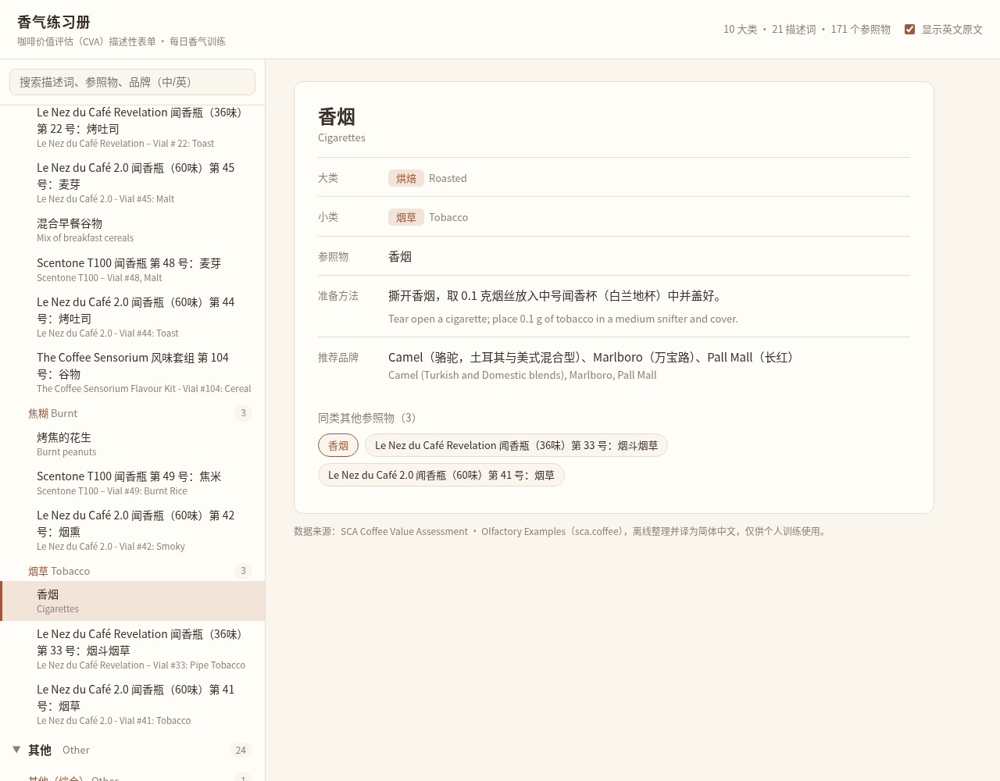

# 香气练习册



把 SCA 咖啡价值评估（CVA）描述性表单的官方嗅觉参照物库整理成中文，方便日常做香气训练。可以作为 macOS 程序使用，也可以在任何电脑的浏览器里直接打开（包括 Windows）。

## 功能
- 收录官方全部 10 个大类、21 个描述词，共 171 个参照物
- 每个参照物都有中文的准备方法和推荐品牌，可以切换显示英文原文
- 左侧大类可以折叠，点一下展开；支持中英文搜索
- 不联网也能用

大类顺序：青绿、花香、果香、酸/发酵、香料、甜、坚果、可可、烘焙、其他

## 安装（Mac）
1. 打开 [Releases 页面](https://github.com/jimmybrst/aroma-workbook/releases/latest)，下载 `aroma-workbook-macos.zip`（[直接下载](https://github.com/jimmybrst/aroma-workbook/releases/latest/download/aroma-workbook-macos.zip)）
2. 双击解压，得到 `香气练习册.app`
3. 把 `香气练习册.app` 拖到「应用程序」文件夹

### 第一次打开
作者不是 App Store 开发者，程序没有经过 Apple 签名，所以第一次打开时 macOS 会拦截。这个程序是开源的，可以放心使用。按你的系统版本操作：

**macOS 14 及更早**
1. 在「应用程序」里右键点 `香气练习册.app`（或按住 Control 键点按）
2. 选「打开」
3. 在弹出的提示里再点「打开」

**macOS 15 Sequoia 及以后**
1. 先双击 `香气练习册.app`，会提示无法打开，点「完成」关掉提示
2. 打开「系统设置 → 隐私与安全性」
3. 滚到下方，找到关于「香气练习册」的提示，点「仍要打开」
4. 输入电脑密码确认

**备用方法（终端）**

如果上面的方法都不行，打开「终端」，粘贴下面这行并按回车：
```
xattr -cr /Applications/香气练习册.app
```
然后双击 `香气练习册.app` 即可。

只有第一次需要这样做，以后直接双击就能打开。

### 不想装程序？用浏览器打开
1. 打开仓库里的 [index.html](https://github.com/jimmybrst/aroma-workbook/blob/main/index.html)，点右上角的下载按钮（Download raw file）把它存到电脑上；或者点仓库首页绿色的「Code」按钮，选「Download ZIP」（[直接下载](https://github.com/jimmybrst/aroma-workbook/archive/refs/heads/main.zip)），解压后找到里面的 index.html
2. 双击 `index.html`，会用默认浏览器（Safari、Chrome 等）打开
3. 数据都在这一个文件里，不用联网

### Windows 电脑
1. 下载 [index.html](https://github.com/jimmybrst/aroma-workbook/blob/main/index.html)（点右上角的下载按钮），或者 [下载整个项目 ZIP](https://github.com/jimmybrst/aroma-workbook/archive/refs/heads/main.zip) 后右键「全部解压缩」
2. 双击 `index.html`，会在 Edge 或 Chrome 中打开（Firefox 也可以）
3. 不需要安装任何程序，也不用联网；字体会自动使用系统自带的微软雅黑

## 参照物怎么选
- 同一个描述词下面会列出多个参照物，选一个就能练，不用全部准备
- 不带品牌名的参照物用超市食材就能自己做，比如欧芹水、白葡萄汁
- 带编号的是商用闻香瓶套装，例如 Le Nez du Café、Scentone、The Coffee Sensorium、FlavorActiV，有哪套就用哪套

## 关于翻译
原料中文名都逐一核对过，官方简体版的错误已经改正，比如柠檬和青柠（莱姆）糖浆写反、黑莓被写成覆盆莓、Revelation 第 22 号和第 23 号写反。拿不准的译名在旁边保留了英文原文。

## 数据来源
[SCA Olfactory Examples](https://sca.coffee/value-assessment/olfactory-examples)。内容归 Specialty Coffee Association 所有，本项目只是整理和翻译，方便大家学习交流。

## 文件
- `index.html`：程序界面，数据已经内置
- `data_en.json` / `data_zh.json`：英文原始数据和中文数据
- `screenshot.png` / `screenshot_windows.png` / `icon_preview.png`：界面截图、Windows 字体效果截图和图标预览
- `aroma-workbook-macos.zip`：macOS 程序（解压得到 `香气练习册.app`），不在仓库里，请到 [Releases 页面](https://github.com/jimmybrst/aroma-workbook/releases/latest) 下载
